> "If I'm an advocate for anything, it's to move. As far as you can, as much as you can. Across the ocean, or simply across the river. The extent to which you can walk in someone else's shoes or at least eat their food, it's a plus for everybody. Open your mind, get up off the couch, move."
> <cite>Anthony Bourdain </cite>

It is both a pleasure and a privilege to be able to travel to different countries. My mom likes traveling, and whenever we visit my family back in Vietnam, we travel to other countries nearby.

Some of her wanderlust definitely rubbed off on me.

I guess I can attribute my fondness for stories, humanity, and culture to that. Also, being a child of Vietnamese immigrants, seeing both the disparity and similarity between my birth country and country of living, definitely influenced my perspective to learn things beyond my circle.

 Tales of old, whispers of a faraway paradise, a Hyperborea up north, or everyday mundanity of an average street food hawker, everyone has a story to tell. Within those stories are desire, humor, discontent. 

 Despite the language barriers and cultural differences, we're all human navigating our own challenges and sharing the same experience of love, pain, happiness. That is true regardless of what era we are in or what the state of the world is. History repeats itself indefinitely until the end of eternity claims us all. 

Wheh, that's a lot of heavy sentiments a few paragraphs ago. I actually just want to share my adventures and food I ate.

On the topic of human experiences, there is no better way to physically immerse yourself in a different culture than via food! 

How something is preserved (if needed at all) can tell us about the weather conditions of a civilization. A diet a village consumed can tell us their proximity to trade or what crops they grow, How complex a dish signifies how complex a civilization is. Food tells us a lot more about culture beyond just the senses!

No easier way to experience culture than to experience it through taste! 

Experiencing things by myself is fun but I also enjoy sharing my adventures.
So, here are some of the countries I visited summer of 2026 and the highlights:

# Bangkok, Thailand

The land of smiles. And land where I exhibit a gluttony the bible warned us about.

What Anthony Bourdain was to Vietnam is what I am to Thailand. 
Probably my favorite country based on food and culture. Evidently so, since I visit Thailand very frequently throughout my life. There are just so many cool things here beyond tourist attractions I keep coming back for. 

# Thailand and Food

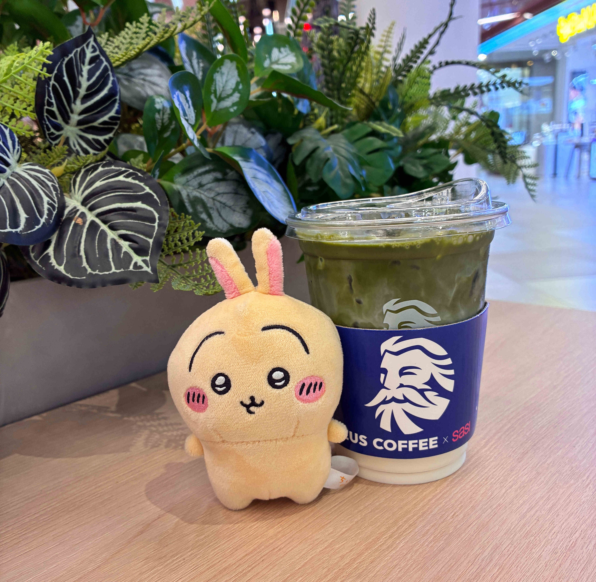

I make it a tradition to bring plushies with me where I go to take cute pictures. It's an internet culture thing but I think it's a cute way to anonymize myself while leaving a personal mark that I went to a certain location or ate a food item. 

(For those of you who into those internet spaces, just think of fumos or nuis.)

My favorite meal of this trip was Khao Soi I got at the mall!

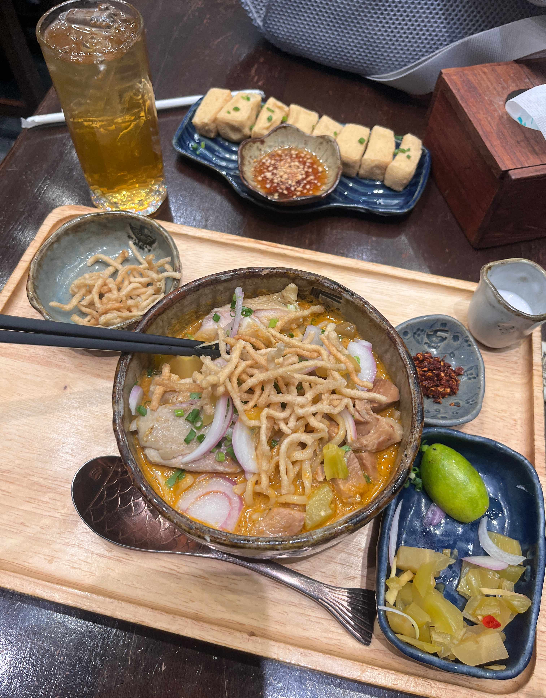

Vietnamese food follow a philosophy that every dish has to have the following: sweet, spicy, salty, sour, bitter and texture(aka crunchy)!!! Khao soi has curry, a myriad of pickled veggies, and of course, the crunchy noodles. It's just so good together!!

Regrettably, I didn't have time to visit Bangkok's Chinatown. I really wanted to go to try their kuay jab...

But one of the food stalls at MBK Center had Five Spice Kuay Jab and I nearly died from how good it was.

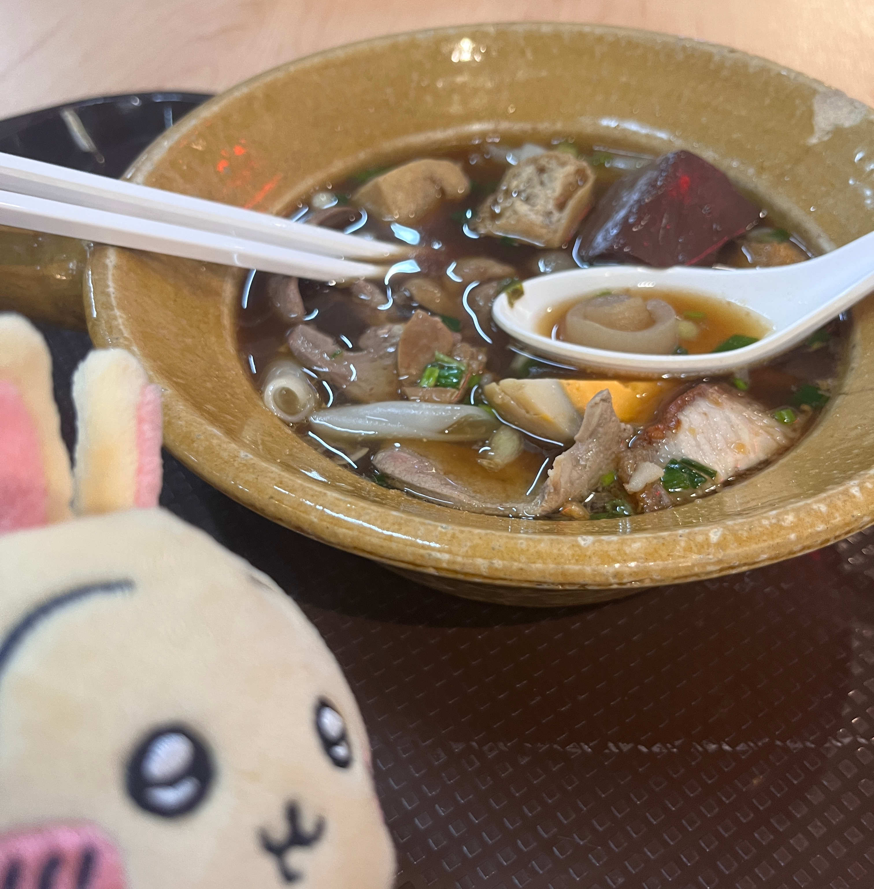

One day I will come back to you!!!

## Fashion and Cosmetic

The cosmetics here are incredible. Watson in other Asian countries are decent but the ones in Thailand are insanely cracked. The samples they have on display is incredible and their products are genuinely so good. 

Southeast Asia is pretty superb and underrated in terms of makeup and fashion. I feel people tend to overlook it in favor of other countries with bigger pop-culture exports. That just makes me want to be more determined about spreading the word and having people look into it. 

# Hong Kong

This is my first time visiting the area and, besides the vague 19th century Hong Kong aesthetic I see in designs, I wasn't familiar with a lot of Hong Kong films/media so I had no idea what to expect. Regardless, I was excited to see the city!

## City and Transportation

When we first arrived in Hong Kong, we were really impressed with the airport and how efficient the train system was. 

Being near the water (river and ocean) and surrounded by mountains, Hong Kong was very humid but not scalding. 

And with the waters and high altitudes, there are many ways you can traverse the city: peak tram, escalators, ferry, trains, buses, oh my! Every mode of transportation is punctual. Walking around the city was very fun! 

While we spent most of our time in Kowloon, we did visit Hong Kong island! Besides the modern area where all the business and luxury malls are, we visited Victoria Peak and other neighborhoods. 

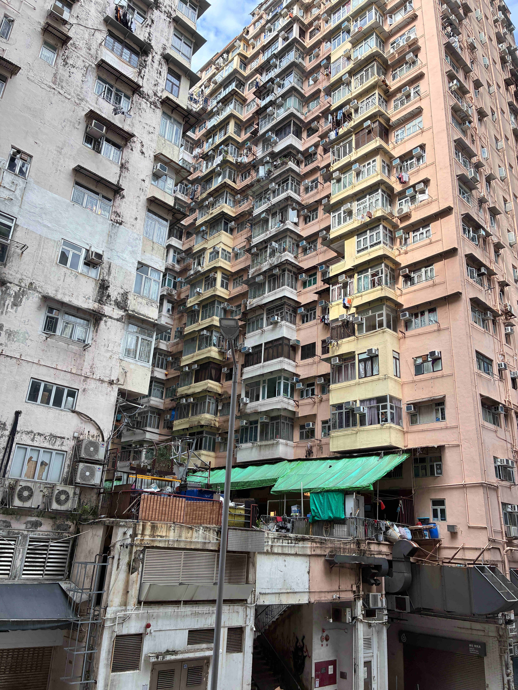

People live in these "Monster Mansions" so while it's a cool building to observe, it's important to be respectful and not disturb the locals. Regardless, there's something cool about the brutalism of it. To an American, it seems imposing but to the people living here, it doesn't seem like something out of the ordinary. 

With the many AC unit blocks, neon signs, and open garage door mechanists I saw, I see where the cyberpunk aesthetic originated from! 
 

Did you know Hong Kong is one of the few remaining places to use bamboo as scaffolding? Apparently bamboo is fire-resistant and durable. How eco-friendly!
Asia seemed to be on a eco-friendly trend, from paper straws and lids, to signs that encourage less toilet paper usage. 

Speaking of space and living quarters, here is the room we stayed!

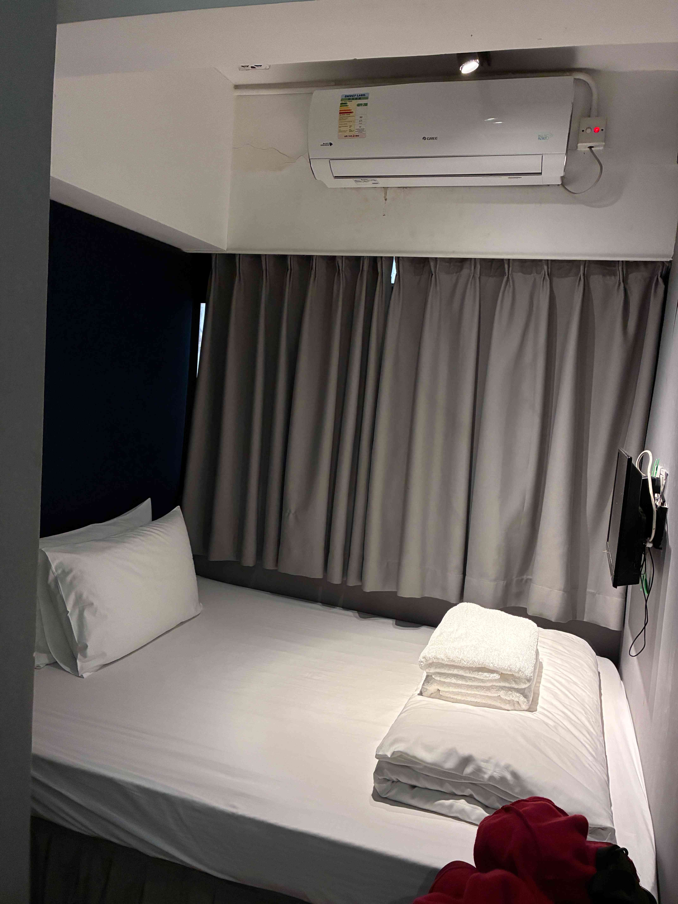

That's it.

Besides a compact bathroom, this is the sleeping space my sibling and I shared! Surprisingly, it was pretty great considering we spent most of the day outside so this small room did its job. 

## Hong Kong and Food

Apparently the most meat consumed per capita! Regrettably, we didn't eat any BBQ/Char Siu.

I tried my first Chagee tea here, an Earl Grey Freeze with Orange Shavings on Whipped Cream. It was the best milk tea I had lol. 

I did try the pineapple buns with the butter slab but it wasn't impressive. Personally, the pastry is better without the slab. Out of all of Hong Kong's iconic pastries, I think pineapple buns are my favorite. 

Pineapple Buns ate: 4.

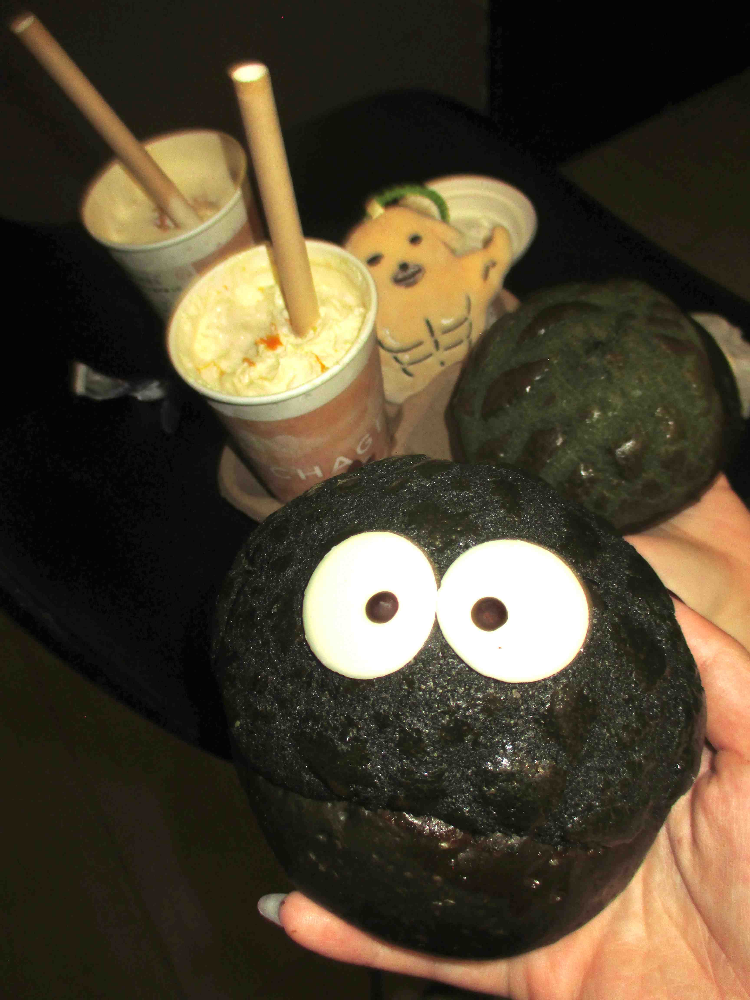
<i>Charcoal Pineapple Buns with Googly Eyes</i>

I didn't go to any places with the old school dim sum dining carts but we had Dim Sum twice! It was amazing both times. 

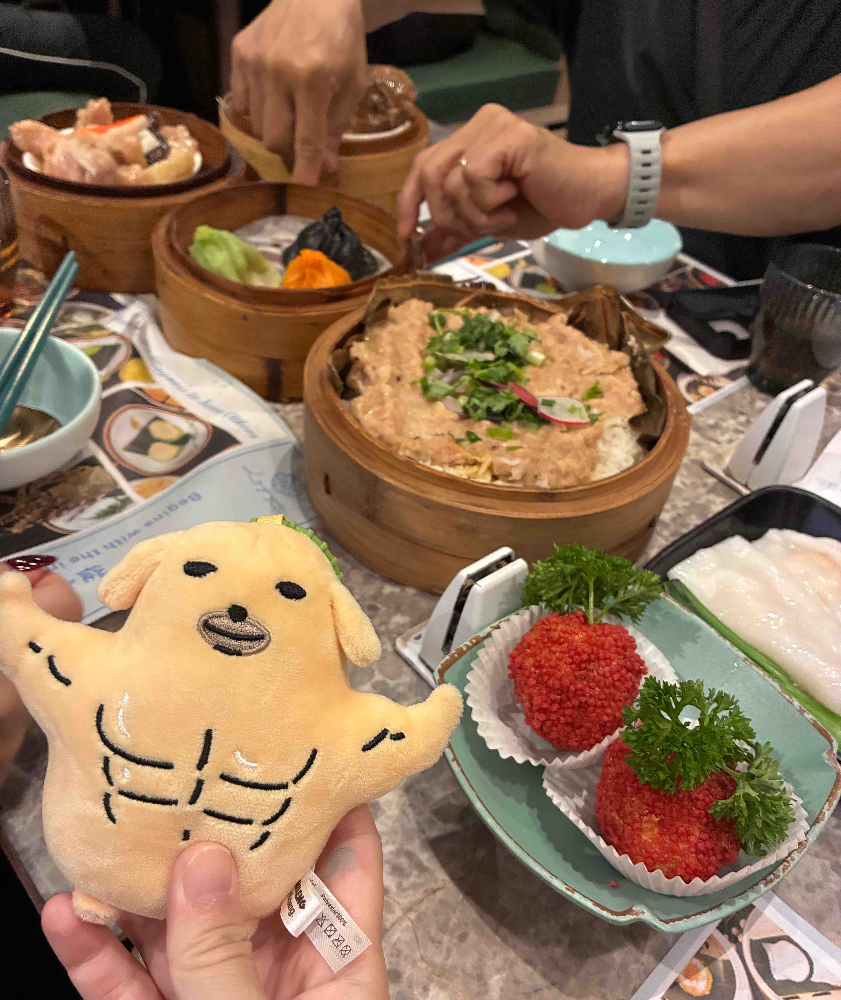

## Chiikawa take over

Netizens were not joking about Chiikawa taking over Hong Kong. 
The two Chiikawa stores in MOKO mall were so crowded!

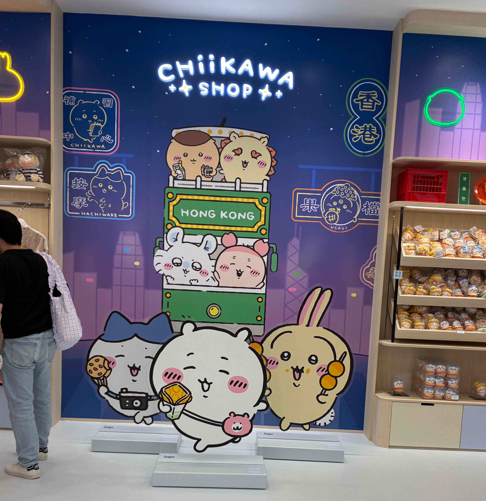

We missed the Chiikawa Star Ferry by a few days but Chiikawa was everywhere! So many people were carrying plushies of the cast.

Speaking of plushies, it felt like just about everybody had a plushie on their bag, kid or elderly folks alike. 

One time, I passed by a security scanner and a security lady stopped me only to squeeze my plushie hanging from my belt loop. 
Plushie culture is strong here!

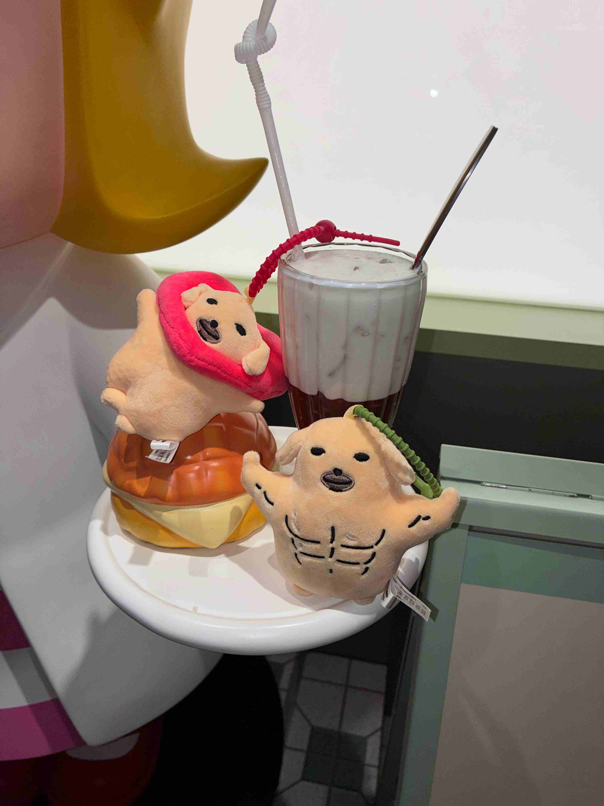
<i>My sister and I's matching Nudaeng plushies</i>

# Japan - Kansai Region

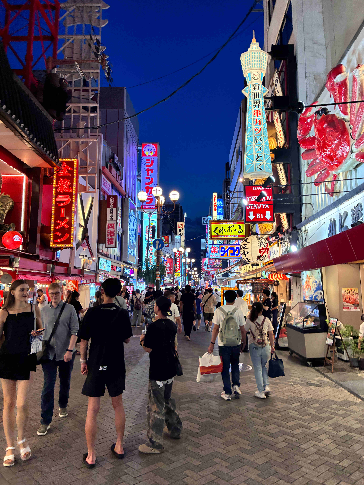

Osaka, also known as the Water City, Kitchen of Japan, or the best city for nightlife in Japan. 

This is my second time in Japan but first time in this region. Needless to say, I had a TON of fun here, infinitely more than Tokyo. So this is the area that inspired the Johto region of Pokemon...

We did mostly sightseeing but the best part of traveling to these countries is the ability to walk nearly everywhere! #Stepmaxxing

I  didn't actually buy a lot of stuff but I really enjoy window shopping!

There's a novelty in looking at the display. Back at home, if I'm learning something new, like about cars, computers, or guitars, I go to the specialty store for it and see what type of stuff they sell. It helps me keep in mind what stuff I might need. 

On an artistic front, graphic designers often look at packaging as inspiration. Packaging and items are designed for sale so why not see what works and what doesn't? Inspiration is everywhere. 

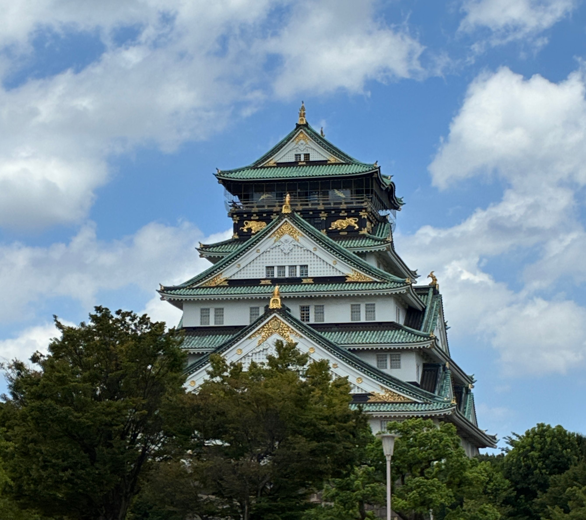

We did visit Osaka Castle on the way to the real tourist attraction.... COSTCO IN JAPAN!!!
Costco is like a holy grail for families. 
Apparently a Costco Membership card works internationally. So naturally, we had to visit. 

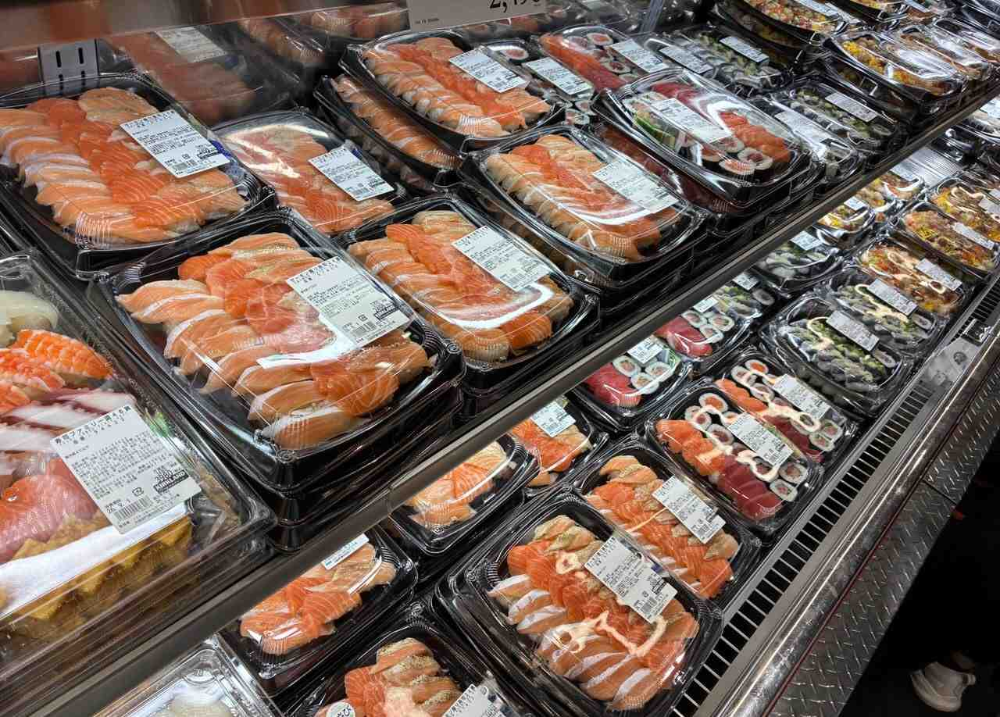

Japanese Costco had so much good stuff it was incredible. UV Sunscreens, sushi, sashimi, tea, bread... We even bought a suitcase here to carry our stuff home. LOL

And yes, my family did clear out the Japanese Costco food court items. 

## Kyoto

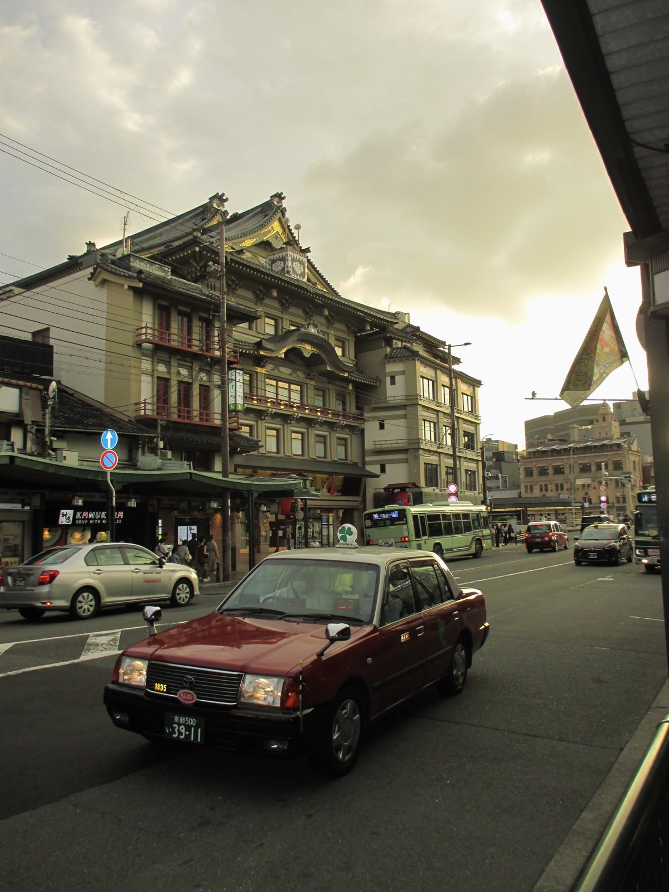

The historical capital.
Kyoto, a beautiful blend of historic and modern buildings. 

I didn't take a photo but Kyoto Station was so impressive. It was huge, within the many spiralling steel interlocking structures, it housed a mall, Chiikawa bakery, and had some indoors and outdoors sections. 

Outside the station, there are patches of mall and suburban areas.

Apparently, there's a 1,000 shrines in the city. With so much to see, it's a lot if fun just walking around and exploring the old architectures.
We were mostly in the Gion District and visited Potencho Alley but it was so cool. 

By the way, we visited the Pokemon Center here and its regional exclusive statue was Ho-Oh. Makes sense since [Ecruteak City is modelled off Kyoto](https://bulbapedia.bulbagarden.net/wiki/Pok%C3%A9mon_world_in_relation_to_the_real_world#Johto).

I'd love to come back to see more of the city. I didn't get to hike Fushimi Inari this time but I'd love to see the infinite red torii gates if I visit again.

## Uji

A little far from Osaka but past the metropolitan cubic structures of the city, you get to see verdant mountains, flowing rivers, and low wooden huts along stone path. 

Perpetual humidity and warm temperatures are perfect for growing tea leaves.
Amidst the lush green of the mountains and grass, the red pop of the bridges adds a mystical feel to the area, almost like a bridge to the other world.

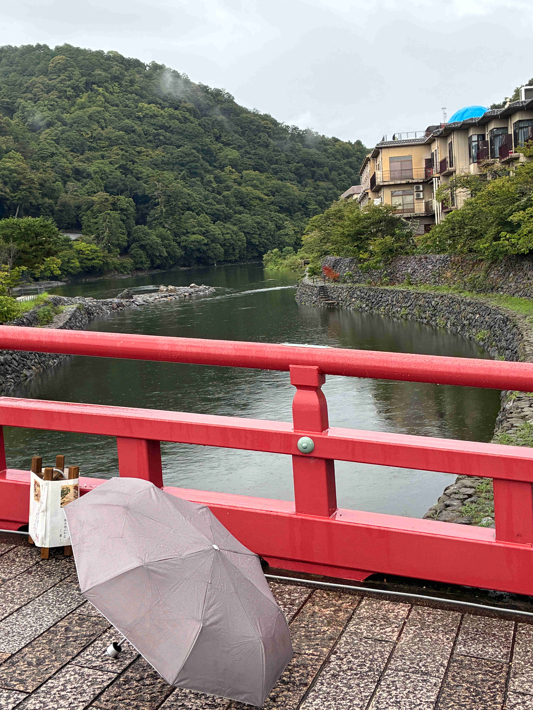

We went out here for the Nintendo Museum originally. We didn't visit any temples or museum but there were a plethora of cultural tourist attractions to behold. 
Kiyomizudera's museum halls were closed when we went so sadly we couldn't go. Note that most of these tourist attractions closed around 5pm.

Anyways, we spent most of the time walking around in the mildly rainy weather. It felt like Animal Crossing based on how peaceful it was. 

I had a great time just being in the matcha capital!

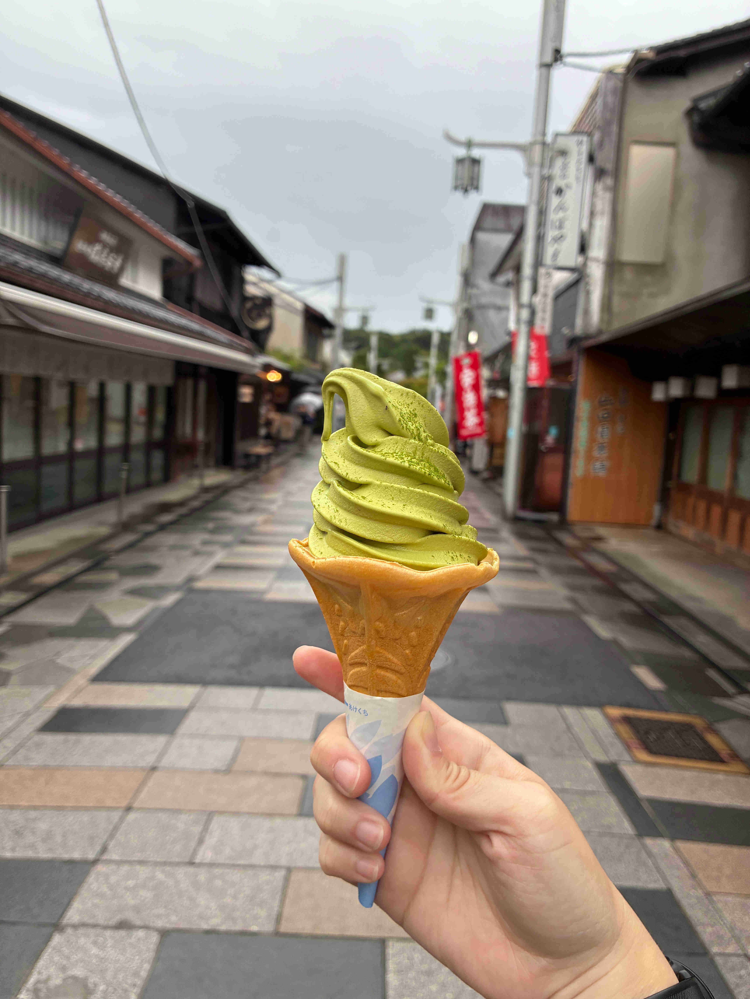

## Kobe

My favorite city in the region! I'm fond of harbor cities with cultural mixes on account of being born near one.

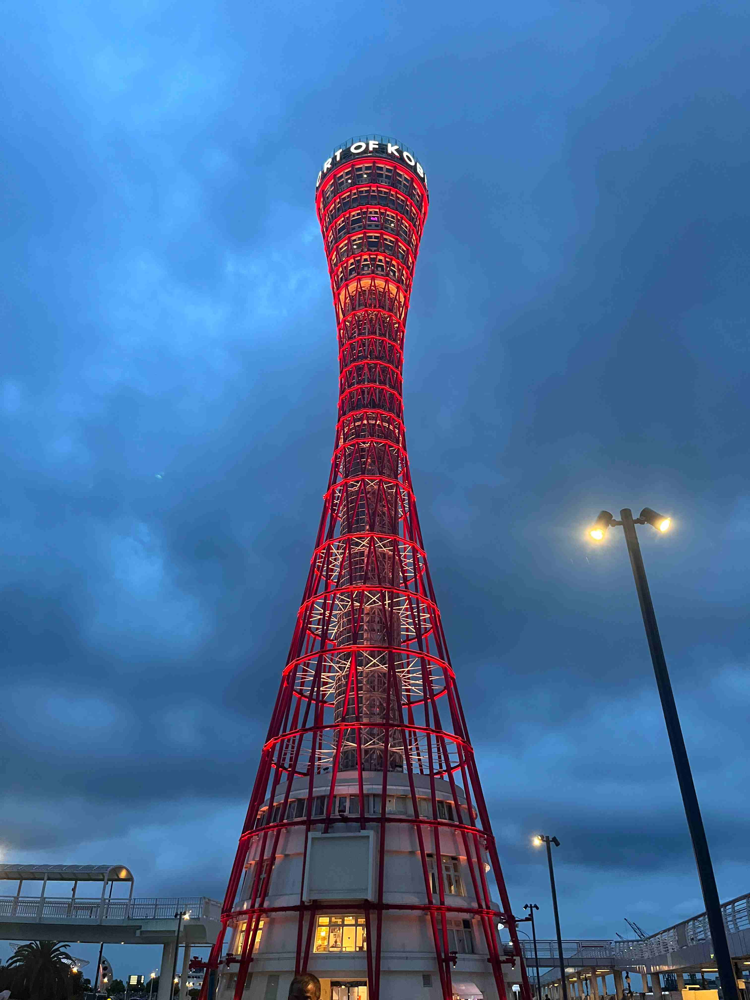

<i>Kobe Tower! This inspired Olivine's Lighthouse in Pokemon.</i>

We arrived at Sannomiya station and were blown away by how much shopping and food was available to us.  All of the food and clothing displays were extravagant and there were stretches of stalls everywhere. It was lively as one would expect.

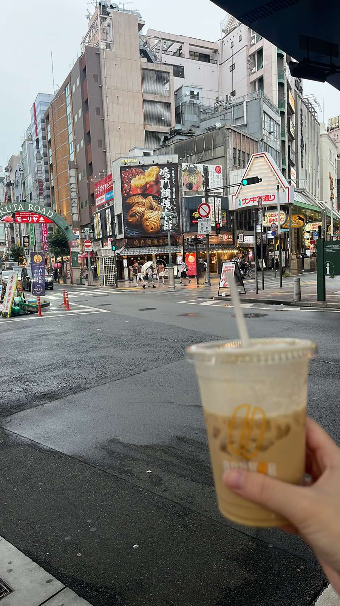

For shopping, I came across Nagasawa for stationeries.

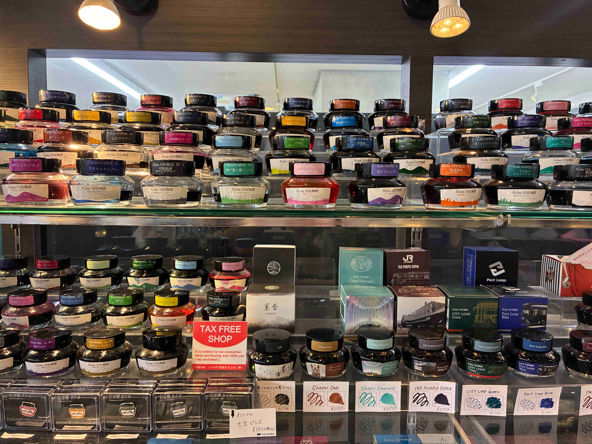

Not sure if it's the combination of low lighting and tight space but I got really dizzy browsing everything. I'm pretty sure it's because I was excited though. Again, art gallery for the consumer.

I wish I got a bottle of Kobe ink for souvenir's sake but I was on a time crunch. 

Also, I learned that ASICs headquarters was in Kobe so I visited and bought a pair of shoes.

## The Beef

It's not a trip to Kobe without mentioning the iconic beef. The thing is, you can get Kobe beef anywhere in Japan so you don't need to be in Kobe for it specifically. 

However, might as well try since we are in the area.However, we might as well try since we were in the area.

Listing some high-quality meat we tried:

Omi Beef - Went to an izakaya for this. Incredibly delicious.

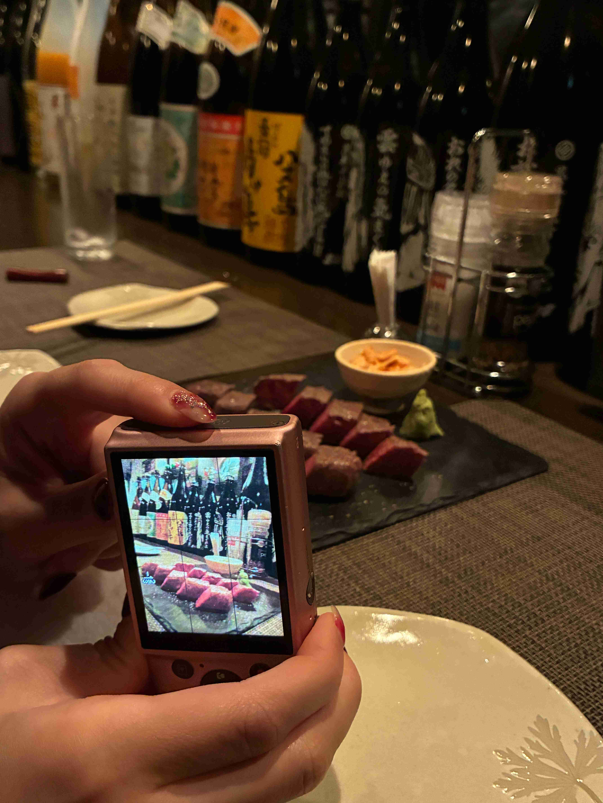

Had a Kobe beef skewer in Nankinmachi where they proudly showed their Kobe Gold Award. It was so good, I don't care if it was a tourist trap.

My sibling and I went to an AYCE Wagyu yakiniku place! We got tired of the fat before being full haha.

## Japan Miscellaneous: Chain Restaurants

I thought of having an offshoot section where I talk about some chain restaurants I like.

### Komaeda's Coffee

If you order a drink before 11am, you can get a complimentary breakfast set consisting of toast, a type of spread (butter or jam) and an egg. My mom and I did try this deal and ordered their black coffee with the free breakfast set. It was so good! Their coffee is pretty nice too. 

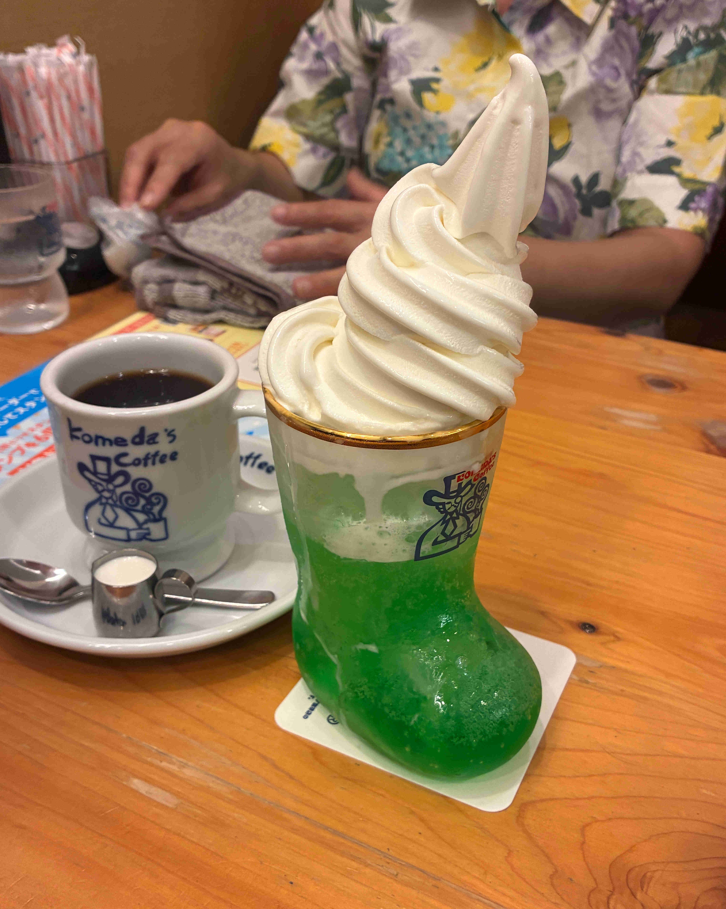

<i>Also, check out their sick iconic melon soda float.</i>

### SUSHIRO

Best chain conveyor-belt sushi restaurant hands down. Each region has their own specialty and best of all, it's not that pricey! 

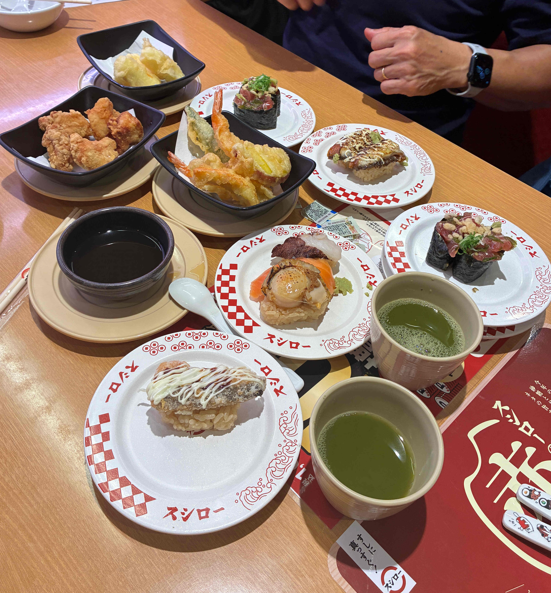
<i>Spread so beautiful, I cry thinking about her</i>

### Mister Donut

I think my favorite Western desserts are donuts. Unfortunately, I'm picky about donuts.

I tried Mister Donut in multiple Asian countries but they tasted TERRIBLE in every one of them except for Japan. 

At the time of my visit, they did a collaboration with Mrs. Green Apple where they cheekily renamed themselves Misses Donut. Cute. 

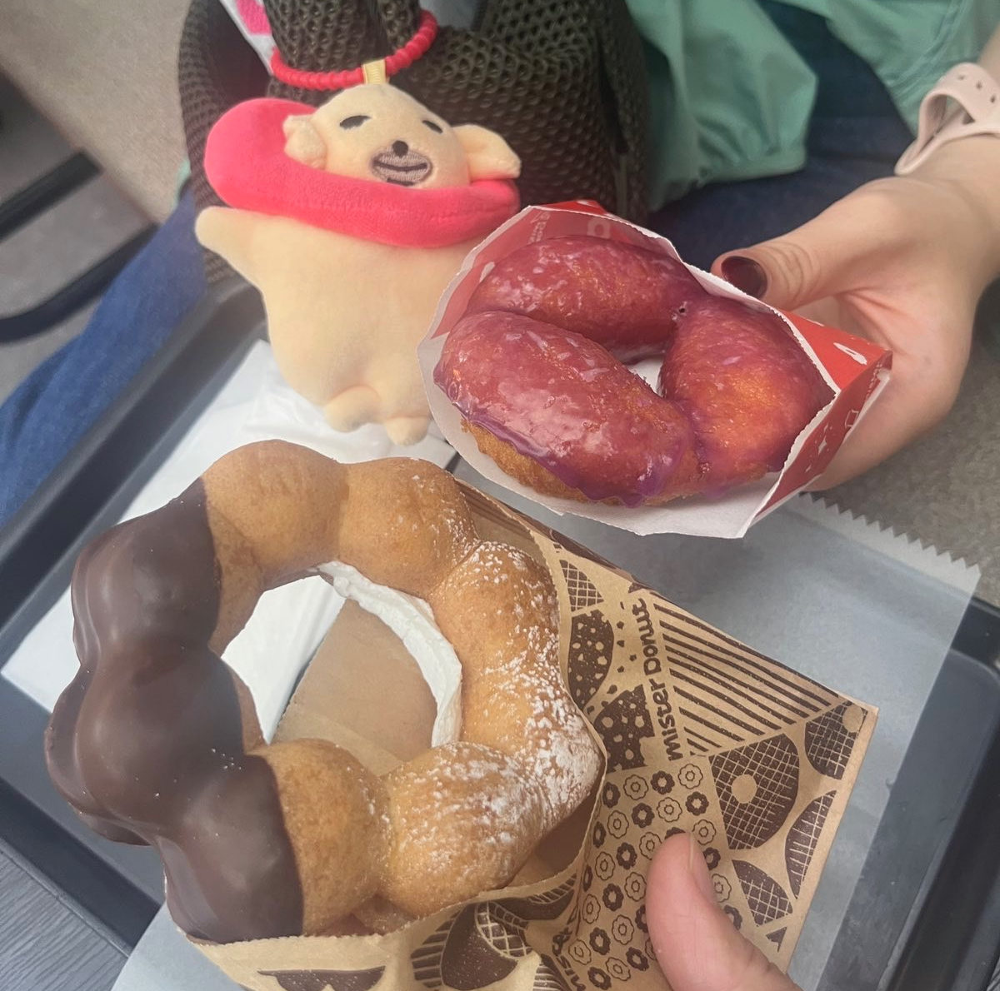

Since Mid-Autumn Festival was close, they had sweet potato themed donuts as promotion. My sister and I tried one of their limited donut and it sure did taste like sweet potato. 

Did you know that Mister Donut was originally an American brand?

# Central Vietnam

Back to the motherland we go.

Where the original Imperial Capital was. The city I was born in is nestled by the mountains and the ocean and river encroaches it on all side.

Also, being central, we have both northern and southern cuisine influences and being by the sea, we have a ton of seafood that makes central cuisine unique compared to the two. The seafood scene is absolutely phenomenal here, by the way. 

Every time I visit, I see new building projects being constructed. 

The city is growing out of the memories I have of this place.

New buildings rise and old structure falls. 

Unlike America, which builds homes with wooden frames and drywall, Vietnam builds its homes out of cement. Cement is easily buildable and destructible, which is needed in a rapidly growing and changing city. 

It's a strange feeling that every time I visit, new parts of the city rise and fall. The area I thought were farm lands are slowly being occupied by new houses. The local market near where I used to live, once bustling, is quiet. 

Pop Mart is in the gaudy tacky Tourist Area now????? Clearly we need more faux gaudy Euro-inspired tourist attractions. (I am bitter)

Anyways, it's bittersweet to see how fast the city changes to say the least. Technically, it is a good thing for economic growth but some of the tourist things offend my eyes.

That isn't to say I didn't enjoy my time back at home. I was being melancholic a few paragraphs ago but I love my city and I love eating Vietnamese food. 

Bowl of Pho ate: 5.

Cups of Ca Phe consumed: near infinity not going to lie.

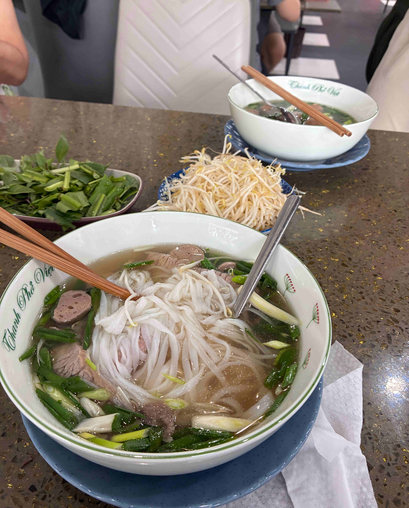

We did visit Hoi An for the day and visited a few places Mr. Bourdain visited. Hoi An is always really fun to visit and walk around.

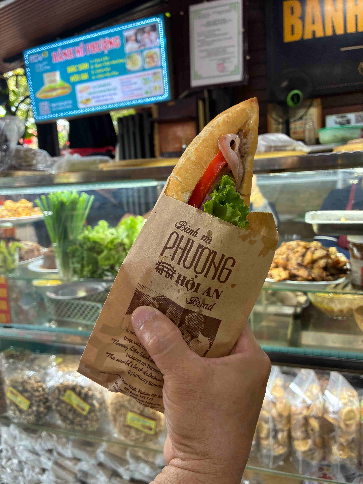

# Closing Statements

Started off with a quote from Mr. Bourdain, it's only fitting to end with one. He inspired a generation of people and there's just no one who captures wanderlust like him. He's a bit before my time but him putting Vietnam on a global televised stage makes me eternally grateful for his work.

I like to think it's good to peer into other sides of the world. Make you a bit wiser, and a bit more learned.

>"Travel changes you. As you move through this life and this world you change things slightly, you leave marks behind, however small. And in return, life - and travel - leaves marks on you. Most of the time, those marks - on your body or on your heart - are beautiful. Often, though, they hurt."
><cite>Anthony Bourdain, The Nasty Bits: Collected Varietal Cuts, Usable Trim, Scraps, and Bones </cite>